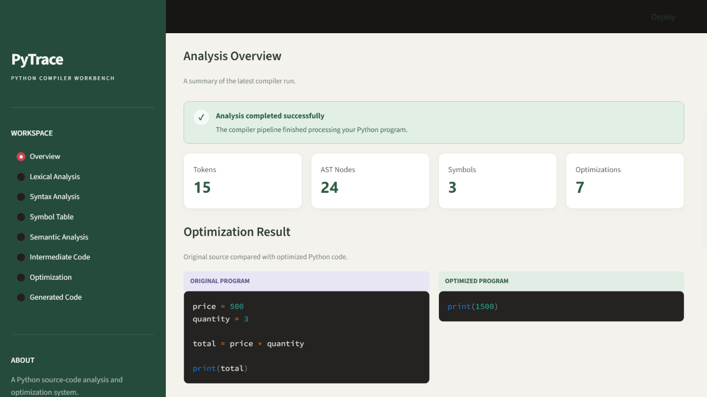

# PyTrace – Python Compiler Optimization & Error Investigation System

**PyTrace** is a Python-based compiler analysis and optimization system that examines Python source code through multiple stages of compilation. It provides lexical analysis, syntax analysis, AST inspection, symbol table construction, semantic analysis, intermediate code generation, code optimization, and execution validation through an interactive Streamlit dashboard.

The project demonstrates fundamental compiler design concepts using Python's built-in parsing capabilities and custom analysis and optimization logic.

## Application Preview

The following screenshot shows the PyTrace interactive dashboard, including its compiler navigation, analysis overview, optimization metrics, and original-versus-optimized code comparison.




## Overview

PyTrace provides an interactive developer workbench where users can explore how Python source code is processed through different compiler stages.

It helps users understand program structure, identify potential programming errors, inspect intermediate representations, and observe code optimization techniques.

## Key Features

- **Lexical Analysis:** Identifies and classifies tokens, including keywords, identifiers, operators, constants, and literals.
- **Syntax Analysis:** Parses Python source code and generates an Abstract Syntax Tree (AST).
- **AST Analysis:** Examines AST nodes and displays structural summaries.
- **Symbol Table Management:** Tracks variables, functions, parameters, data types, assignments, references, and scopes.
- **Semantic Analysis:** Detects issues such as undefined variables and provides warnings for unused variables and multiple assignments.
- **Intermediate Code Generation:** Converts supported Python constructs into a three-address-style intermediate representation.
- **Code Optimization:** Implements constant folding, constant propagation, and dead code elimination.
- **Code Generation:** Generates Python source code from the optimized AST.
- **Execution Validation:** Compares the standard output of original and optimized programs.
- **Interactive Dashboard:** Provides a Streamlit interface for exploring each stage of the compiler pipeline.

## Technologies Used

| Technology | Purpose |
|---|---|
| Python | Core programming language |
| Streamlit | Interactive frontend and dashboard |
| AST | Syntax tree generation and analysis |
| Tokenize | Lexical analysis |
| Pandas | Tabular presentation of results |
| Pytest | Automated testing |

## System Architecture

PyTrace follows a sequential compiler analysis pipeline:

```text
Source Code Input
       |
       v
Lexical Analysis
       |
       v
Syntax Analysis
       |
       v
AST Analysis
       |
       v
Symbol Table Construction
       |
       v
Semantic Analysis
       |
       v
Intermediate Code Generation
       |
       v
Code Optimization
       |
       v
Python Code Generation
       |
       v
Execution Validation
```

Each stage contributes to analyzing, transforming, or validating the source program.

## Project Structure

```text
PyTrace/
│
├── compiler/
│   ├── __init__.py
│   ├── lexer.py
│   ├── parser.py
│   ├── symbol_table.py
│   ├── semantic.py
│   ├── intermediate.py
│   ├── optimizer.py
│   ├── code_generator.py
│   ├── validator.py
│   └── pipeline.py
│
├── samples/
│   └── sample.py
│
├── tests/
│   ├── test_lexer.py
│   ├── test_parser.py
│   ├── test_symbol_table.py
│   ├── test_semantic.py
│   ├── test_intermediate.py
│   ├── test_optimizer.py
│   ├── test_code_generator.py
│   ├── test_validator.py
│   └── test_pipeline.py
│
├── app.py
├── requirements.txt
├── README.md
└── .gitignore
```

## Installation and Setup

### Prerequisites

- Python 3.10 or later
- pip
- Git

### 1. Clone the repository

```bash
git clone https://github.com/khushigupta89790/PyTrace.git
cd PyTrace
```

### 2. Create a virtual environment

**Windows (PowerShell):**

```powershell
python -m venv .venv
```

Activate the environment:

```powershell
.venv\Scripts\Activate.ps1
```

### 3. Install dependencies

```bash
pip install -r requirements.txt
```

## Running the Application

Start the Streamlit application:

```bash
streamlit run app.py
```

Open the local URL displayed in your terminal, usually:

```text
http://localhost:8501
```

Enter Python source code in the editor and select **Run Analysis** to explore the compiler pipeline.

A sample Python program is also available in the `samples/` directory.

## Running Automated Tests

PyTrace includes an automated test suite implemented using Pytest.

Run all tests using:

```bash
python -m pytest tests -v
```

The test suite covers:

- Lexical analysis
- Syntax analysis
- Symbol table construction
- Semantic analysis
- Intermediate code generation
- Code optimization
- Code generation
- Execution validation
- Complete pipeline integration

**Latest recorded test result: 48 tests passed.**

## Current Limitations

PyTrace is an educational compiler analysis and optimization system, not a complete implementation of the Python language compiler.

- Intermediate code generation supports selected Python constructs; unsupported expressions may raise an explicit error.
- Semantic analysis implements selected static checks and does not provide complete Python scope or control-flow analysis.
- Optimization is conservative and does not cover every Python construct or execution scenario.
- Execution validation compares standard output and does not establish equivalence of all program behaviour.
- The execution validator uses subprocess execution with a timeout. It is not a secure sandbox, so only trusted source code should be executed.

## Future Enhancements

- Expand support for additional Python syntax and expressions.
- Improve semantic analysis and scope handling.
- Extend intermediate representation and optimization techniques.
- Improve optimization safety for complex control-flow structures.
- Add richer compiler diagnostics and debugging information.
- Introduce more comprehensive execution and equivalence testing.

## Learning Outcomes


This project demonstrates practical implementation of fundamental compiler design concepts, including:

- Lexical analysis and parsing
- Abstract Syntax Tree traversal
- Symbol table construction
- Semantic analysis
- Intermediate representation
- Code optimization
- Code generation
- Automated software testing

It also demonstrates the integration of a Python backend with an interactive Streamlit frontend.

---

**Project:** PyTrace – Python Compiler Optimization & Error Investigation System

**Developed using:** Python, Streamlit, Pandas, and Pytest.

**GitHub Repository:** https://github.com/khushigupta89790/PyTrace
